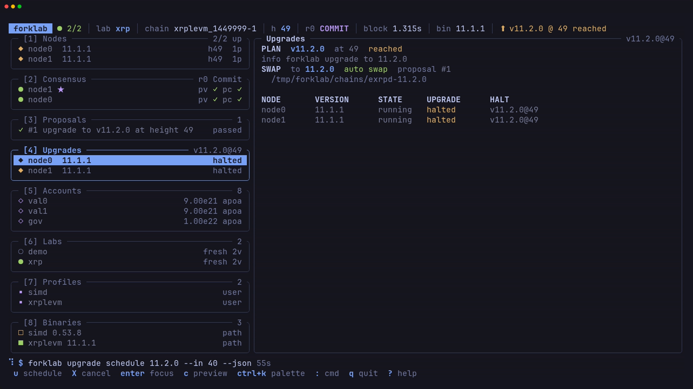
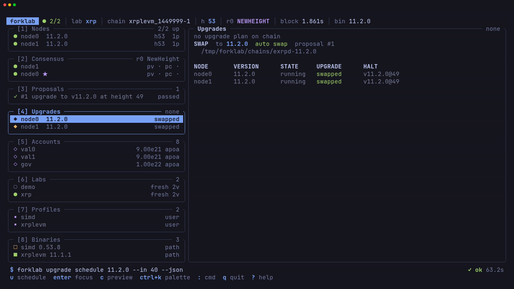

# Upgrades

forklab rehearses a software upgrade end to end: the governance proposal, the
halt at the plan height, and the restart on the new binary.

## Schedule an upgrade

The `xrplevm` profile downloads `exrpd` release binaries. This lab starts on
11.1.1 and upgrades to 11.2.0:

```sh
forklab lab create xrp --profile xrplevm --version 11.1.1 --validators 2 --chain-id xrplevm_1449999-1
forklab lab up xrp
forklab upgrade schedule 11.2.0 --in 45
forklab upgrade status
```

`upgrade schedule` fetches the new binary, submits a software upgrade
proposal, votes it through, and waits. The plan name comes from the profile's
`upgrade_name` unless you pass `--name`. forklab refuses the names `.` and
`..` in every lab. `--height` sets an absolute plan
height instead of `--in`, and `--no-wait` returns as soon as the plan is
registered.

The plan height must be after the end of the voting period, so `--in` must
cover the voting period in blocks plus a small margin. forklab refuses a
height that is too close and names the smallest one that works.

> [!IMPORTANT]
> This fresh lab needs `--chain-id xrplevm_1449999-1`. The XRPL EVM v11.2.0
> upgrade handler does escrow work only on the mainnet chain id
> `xrplevm_1440000-1`, and that work fails on a fresh genesis that lacks
> mainnet state. A [forked lab](fork-mode.md#chain-id) keeps the mainnet id.

In the TUI, `u` on the Upgrades panel opens the same command as a form.

## Automatic swap

When the nodes halt at the plan height, the supervisor restarts each one on
the new binary, and `upgrade schedule` returns once blocks are produced past
that height.

Both nodes halt at the plan height:



The supervisor swaps them to the new binary and blocks continue:



## Manual swap

Use `--no-auto-swap` to leave the halted nodes alone and restart them yourself,
for example to test mixed versions or a restart order:

```sh
forklab upgrade schedule 11.2.0 --in 45 --no-auto-swap
forklab node restart --binary 11.2.0 0
forklab node restart --binary 11.2.0 1
```

## Cosmovisor mode

By default the forklab supervisor swaps the binaries. A lab created with
`--cosmovisor` runs every node under
[cosmovisor](https://docs.cosmos.network/main/build/tooling/cosmovisor), and
cosmovisor switches the binary at the plan height, as on a real validator.
forklab still submits the proposal, votes, and reports the state.

```sh
forklab lab create xrp --profile xrplevm --version 11.1.1 --validators 2 --chain-id xrplevm_1449999-1 --cosmovisor
forklab lab up xrp
forklab upgrade schedule 11.2.0 --in 45
```

forklab builds cosmovisor from the cosmos-sdk repository the first time a lab
needs it and caches it, which needs `git` and Go 1.27.3 or later. The mode is
fixed when the lab is created. `lab show` names it, and `node list` marks
each pid `(cosmovisor)`: the pid is cosmovisor's, and the chain binary is its
child.

> [!IMPORTANT]
> The cosmovisor forklab builds is not a release. It is
> [cosmos-sdk pull request 26879](https://github.com/cosmos/cosmos-sdk/pull/26879)
> at commit `58bf3aad3787`, shown as `pr26879-58bf3aad3787` in the cache
> path: the cosmos-sdk `main` branch plus a fix that no release has yet.
> Cosmovisor v1.7.3 exits with code 1 as soon as it is told to stop after
> it has performed an upgrade, and leaves the chain binary running. The
> binary then gets killed instead of shutting down. forklab returns to a
> release when one carries the fix.
>
> To see the behavior of a stock release, pass it with
> `--cosmovisor-bin <path>`. That flag takes any cosmovisor you already
> have.

Each node home gets the usual cosmovisor tree:

| Path | Contents |
|------|----------|
| `cosmovisor/genesis/bin/<binary>` | The binary the lab was created with |
| `cosmovisor/upgrades/<plan>/bin/<binary>` | The binary for an upgrade plan |
| `cosmovisor/forklab-manual/bin/<binary>` | Any other binary you tell forklab to run |
| `cosmovisor/current` | A link to the directory in use |

`<plan>` is the plan name in lower case. Cosmovisor lower-cases the name
before it looks for the directory, so the binary for a plan named `V2` is in
`upgrades/v2`. A plan named `.` or `..` would have no directory of its own,
which is why forklab refuses those names.

forklab puts a copy of each binary in the tree and does not link to your
file. Cosmovisor sets the execute bits of the binary it runs, and a link
would change the mode of the original. Where the file system can clone
files, as btrfs does and XFS does when it was made with reflink support, and
the binary is on the same file system as the lab, a
copy shares its blocks with the original. Elsewhere each directory of each
node holds the binary once more. forklab empties a plan's directory when the
plan is cancelled, recovered from, or replaced by another plan, also one of
the same name, unless the node runs from it. A plan that is set again with
the same name and height counts as the same plan and keeps its directory.

In a cosmovisor lab each node's `config/client.toml` names that node's own
RPC port. Before it acts on an upgrade, cosmovisor waits for `<binary> status
--home <home>` to report the plan height, and that command reads
`client.toml`.

The commands on this page work the same in a cosmovisor lab. These are the
differences:

- **Scheduled upgrade.** `upgrade schedule` puts the new binary in
  `cosmovisor/upgrades/<plan>/bin/` on every node as soon as the plan is
  registered. At the plan height the node halts, cosmovisor moves `current`
  to that directory, and it starts the new binary. The pid does not change.
  `upgrade status` shows the node as `swapped` once the link has moved.
- **Download.** Create the lab with `--cosmovisor-download` and forklab
  places nothing. The proposal's plan `info` carries a link,
  `{"binaries":{"linux/amd64":"<url>?checksum=sha256:<hex>"}}`, and
  cosmovisor downloads the binary itself. The link is the version's `url`
  source from the profile, and the checksum is the sha256 of the file
  forklab downloaded from that URL, so the chain does not need to publish
  checksums. Downloading is a lab setting because cosmovisor reads it when
  it starts. `upgrade schedule` refuses a version that cosmovisor could not
  download, before it submits the proposal:
  - a version with a `path`, `git`, or `src` source;
  - a `.tar.lz4` archive, which cosmovisor cannot unpack;
  - an archive with the binary anywhere but `<binary>` or `bin/<binary>` at
    the top. forklab itself finds the binary at any depth, so such a source
    works in other labs.
- **`--no-auto-swap`.** forklab delivers no binary and no download link.
  At the plan height cosmovisor finds no binary and exits, and the node
  shows as halted. Run `forklab node restart <i> --binary <version>`, or put
  the binary in `cosmovisor/upgrades/<plan>/bin/` yourself and run
  `forklab node start <i>`. The node halts only while that directory is
  empty: when you put the binary there before the plan height, cosmovisor
  switches to it at the height like in a scheduled upgrade.
- **`node restart --binary`.** forklab stops cosmovisor, puts the binary in
  the tree, points `current` at it, and starts cosmovisor again. The pending
  plan's binary goes in the plan's directory, and any other binary goes in
  `cosmovisor/forklab-manual`.
- **`upgrade recover`.** `--previous` and `--version` change `current` the
  same way before they restart the validators.
- **`lab reset`.** The reset removes the cosmovisor tree. The next start
  builds it again with the creation binary in `genesis`.

> [!NOTE]
> forklab starts cosmovisor with `UNSAFE_SKIP_BACKUP=true`. Without it
> cosmovisor copies the whole data directory before each upgrade, which is
> slow in a forked lab. The rehearsal does not cover that backup.

## Status and cancel

`forklab upgrade status` shows the scheduled plan and each node's version and
swap state. `forklab status` also lists any pending upgrade.

`forklab upgrade cancel` cancels a scheduled plan through governance.

## Recover a failed upgrade

Press `U` in the TUI when an upgrade needs attention. The recovery form lets
you review either action before restarting all validators:

```sh
forklab upgrade recover --lab xrp --previous
forklab upgrade recover --lab xrp --version 11.2.0
```

`--previous` switches each node to its recorded previous binary and skips the
failed upgrade height. It keeps existing chain data; it does not restore a
checkpoint. `--version` retries the pending upgrade with a version from the
lab's profile. Recovery disables automatic swapping before changing nodes
and succeeds only after every node runs its intended binary and produces
fresh blocks past the upgrade height.

`upgrade status` keeps the pending plan, previous binaries, and node errors
available when the chain is down. The TUI shows the recovery action above
node logs and in the Upgrades panel. Recovery progress continues in the
background if you close the form with `Esc`.

## Expedited proposals

Upgrade and cancel proposals are regular proposals by default. Pass
`--expedited` to `upgrade schedule`, `upgrade cancel`, or `gov submit` to
submit an expedited one. forklab then uses the chain's expedited voting period
and expedited minimum deposit, so the smallest valid `--in` shrinks. The
built-in profiles set the expedited voting period to 20s.

## Reset after an upgrade

`forklab lab reset <name>` wipes every node's chain data so the lab replays
from genesis. Replaying needs the binary the lab was created with, so reset
puts every node back on that version and forgets any pending upgrade. Keys and
genesis stay. The lab must be down, or pass `--force` to bring it down first.
Run the same rehearsal again after a reset.
